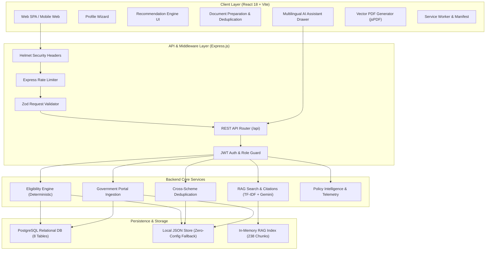

# JanSahay AI 🇮🇳

> **Production-Quality Government Scheme Discovery & Statutory Document Platform**  
> An open-source, citizen-centric GovTech platform that bridges the gap between Indian citizens and public welfare programs through deterministic eligibility evaluation, automated document deduplication, statutory 9-point document acquisition roadmaps, and grounded multilingual AI assistance in **English, Marathi (मराठी), and Hindi (हिंदी)**.

[](LICENSE)
[](https://github.com/dharshanmende-afk)
[](client)
[](server)
[](server/prisma/schema.prisma)
[](server/tests)
[](server/vitest.config.js)
[](server/data/jansahay-db.json)
[](docker-compose.yml)

---

## 📌 Problem Statement

Every year, thousands of welfare schemes and financial subsidies launched by Central and State Governments in India go underutilized. Everyday citizens, students, and marginal farmers struggle with three systemic barriers:

1. **Information Asymmetry & Fragmented Portals**: Welfare schemes are scattered across disconnected portals (`myscheme.gov.in`, `data.gov.in`, `mahadbt.maharashtra.gov.in`, `aaplesarkar.mahaonline.gov.in`), making discovery daunting.
2. **Opaque & Complex Eligibility Criteria**: Guidelines are buried in lengthy gazettes with interdependent requirements (caste category, annual income, domicile, land ceiling, academic qualifications).
3. **The "Document Barrier"**: Citizens frequently face rejection due to missing prerequisite certificates (Income Certificate, Non-Creamy Layer, Caste Validity, 7/12 Land Extract). Many do not know the issuing authority, fees, or statutory delivery timelines mandated under the **Right to Public Services (RTS) Act**.

**JanSahay AI** eliminates this friction by transforming welfare discovery into an automated, transparent, and step-by-step roadmap.

---

## 🌟 Key Features (Implemented & Verified)

| Feature | Description |
| :--- | :--- |
| **🎯 Deterministic Eligibility Matching** | Evaluates user demographic, economic, and occupational profiles against rules engine; outputs transparent **Strong Match**, **Potential Match**, or **More Information Required** with condition-by-condition match diagnostics. (98.7% test coverage) |
| **📑 Citizen In-Hand Document Registry** | Citizens track certificates already in their possession; when inspecting any scheme, requirements are automatically partitioned into *Ready in Hand* vs *Pending Acquisition*. |
| **🔄 Cross-Scheme Document Deduplication** | Automatically computes common prerequisites across multiple eligible schemes so users prepare documents once without redundant applications. (97.2% test coverage) |
| **🗺️ 14 Statutory 9-Point RTS Document Guides** | Comprehensive step-by-step acquisition guides for essential certificates (Income, Domicile, EWS, Caste Validity, 7/12 & 8A, UDID, Birth, Police Clearance) including issuing officers, RTS SLA timelines, prescribed fees, and official links. |
| **🌐 Native Trilingual Experience** | Instant full-app language toggling across **English**, **Marathi (मराठी)**, and **Hindi (हिंदी)** for all navigation, scheme summaries, and document requirements. |
| **🤖 Grounded Multilingual RAG AI** | Conversational drawer that answers citizen queries strictly against verified scheme data and RTS rules with explicit citations, avoiding AI hallucinations (100% benchmark score on 31 queries). |
| **📄 Official Vector PDF Exports** | Client-side vector PDF generation using `jspdf` for official citizen scheme eligibility dossiers and deduplicated checklists. |
| **📱 Progressive Web App (PWA)** | Installable web app with Service Worker offline caching for rural and low-connectivity scheme catalog access. |
| **📊 Administrative Policy Analytics & Sync** | Granular dashboard for public servants to inspect platform telemetry, view in-demand schemes, citizen missing document bottlenecks, and language usage. |
| **🐳 Cloud & DevOps Infrastructure** | Multi-stage Dockerfiles (`<30MB` client, `<120MB` server), Docker Compose stack, GitHub Actions CI/CD pipeline, and Netlify / Render deployment configs. |

---

## 🏗️ System Architecture



---

## 💻 Tech Stack

### Frontend
| Component | Technology | Version | Purpose |
| :--- | :--- | :--- | :--- |
| **Framework** | React | `^18.3.1` | Component-driven user interface |
| **Build Tool** | Vite | `^5.4.21` | Fast HMR and optimized production bundling |
| **Routing** | React Router DOM | `^6.24.1` | Declarative client-side routing |
| **HTTP Client** | Axios | `^1.7.2` | REST API communication with JWT interceptors |
| **PDF Generation**| jsPDF | `^2.5.2` | Client-side vector PDF dossiers & checklists |
| **Icons** | Lucide React | `^0.395.0` | Modern, clean UI iconography |
| **Offline / PWA** | Web App Manifest + Service Worker | - | Offline catalog caching for low connectivity |

### Backend & Core Services
| Component | Technology | Version | Purpose |
| :--- | :--- | :--- | :--- |
| **Runtime** | Node.js (ESM) | `v20+ LTS` | Server-side JavaScript runtime |
| **Web Framework** | Express.js | `^4.19.2` | REST API endpoints and routing |
| **Security** | Helmet + Express-Rate-Limit | Latest | Security headers and DoS mitigation |
| **Validation** | Zod | `^4.6.7` | Type-safe schema validation |
| **Authentication** | JSON Web Tokens (`jsonwebtoken`) | `^9.0.2` | Stateless bearer token authentication |
| **Password Hashing**| BCrypt (`bcryptjs`) | `^2.4.3` | Salted credential encryption |
| **Database** | PostgreSQL + High-Performance Local JSON | `v16+` | Dual-mode persistence with zero-config fallback |
| **AI / RAG** | Google Gemini 1.5 Flash + TF-IDF Index | Latest | Grounded semantic retrieval with citations |

### DevOps & Infrastructure
| Component | Technology | Purpose |
| :--- | :--- | :--- |
| **Containers** | Docker & Docker Compose | Multi-stage production containerization |
| **Web Server** | Nginx Alpine (`1.27`) | Production client server with SPA rewrite |
| **CI/CD** | GitHub Actions | Automated matrix testing and Docker builds |
| **Hosting** | Netlify (Client) & Render (Backend) | Live production cloud deployment |

---

## 🚀 Setup & Installation

### Prerequisites
- **Node.js**: `v18.0.0` or higher
- **npm**: `v9.0.0` or higher
- **Git**
- *(Optional)* **Docker Desktop** / **PostgreSQL 14+**

---

### Option A: Local Development Setup (Quickstart)

1. **Clone the repository**:
   ```bash
   git clone https://github.com/dharshanmende-afk/jansahay.git
   cd jansahay
   ```

2. **Configure environment variables**:
   ```bash
   cp server/.env.example server/.env
   cp client/.env.example client/.env
   ```

3. **Install all dependencies** (single command):
   ```bash
   npm run install:all
   ```

4. **Initialize & seed database**:
   ```bash
   cd server
   npm run seed
   ```

5. **Start development servers**:
   - **Terminal 1 (Backend Server)**:
     ```bash
     npm run server:dev
     ```
   - **Terminal 2 (Frontend Client)**:
     ```bash
     npm run client
     ```

6. **Open in browser**:
   - Web Application: `http://localhost:5173`
   - Backend REST API: `http://localhost:5000/api`

---

### Option B: Docker Compose (One-Command Production Stack)

Run the complete multi-tier application stack:
```bash
docker compose up --build
```
This starts:
- **PostgreSQL 16**: `localhost:5432`
- **Node.js API Server**: `localhost:5000`
- **Nginx Web Client**: `localhost:80`

---

### Option C: Windows One-Click Scripts

For Windows developers, automated batch scripts are in `scripts/windows`:
```cmd
# Setup dependencies and environment
.\scripts\windows\setup.bat

# Launch both servers in separate windows
.\scripts\windows\run.bat
```

---

## 🧪 Testing & Quality Assurance

JanSahay AI includes automated unit, security, and API integration tests powered by **Vitest** and **Supertest**:

```bash
# Run ESLint check across server source & tests
npm run lint

# Run complete test suite (66 tests passing)
npm test

# Run test coverage analysis (@vitest/coverage-v8 — 84.12% line coverage on services/)
npm run test:coverage

# Run multilingual RAG benchmark evaluation (31 test prompts)
npm run eval:rag

# Build production client bundle
npm run build
```

---

## ⚙️ Environment Variables

### Server (`server/.env`)
| Variable | Required | Default | Description |
| :--- | :---: | :--- | :--- |
| `PORT` | No | `5000` | Port for Express API server |
| `NODE_ENV` | Yes | `development` | `development` or `production` |
| `DATABASE_URL` | No | - | PostgreSQL connection URL (falls back to local JSON if unset) |
| `JWT_SECRET` | Yes | - | Secret key for signing access tokens (min 32 chars) |
| `JWT_EXPIRES_IN` | No | `15m` | Access token lifespan |
| `JWT_REFRESH_SECRET` | Yes | - | Secret key for refresh tokens |
| `JWT_REFRESH_EXPIRES_IN` | No | `7d` | Refresh token lifespan |
| `CORS_ORIGIN` | No | `http://localhost:5173` | Allowed CORS origins |
| `AI_PROVIDER` | No | `deterministic` | `gemini` or `deterministic` |
| `GEMINI_API_KEY` | Conditional | - | Required when `AI_PROVIDER=gemini` |

### Client (`client/.env`)
| Variable | Required | Default | Description |
| :--- | :---: | :--- | :--- |
| `VITE_API_URL` | Yes | `http://localhost:5000/api` | Base URL of backend REST API |

---

## 🗺️ Roadmap (Engineering Phases)

- [x] **Prisma ORM Integration (Phase 2)**: Migrated schema to Prisma ORM with 10 PostgreSQL tables, committed DDL migrations, and random dev credential seeding.
- [x] **Security & DPDP Privacy (Phase 3)**: JWT refresh token family rotation with reuse detection, Pino structured redacted logging, Zod route validation, DPDP Privacy Policy UI, and `delete-my-data` / `delete-my-account` endpoints.
- [x] **Vitest Testing & Coverage (Phase 4)**: Vitest + Supertest unit/boundary/integration test suite achieving **84.12% line coverage** on `services/` and ESLint checks.
- [x] **Dynamic Conversational AI Agent (Phase 5)**: Multi-turn conversational agent using Gemini function calling + automatic deterministic multi-tool fallback (`limitedMode`), 7 Zod-validated tools, SSE streaming chat UI, prompt-injection & citation post-check guards, and 55-case multilingual evaluation benchmark ([`AI_EVALUATION.md`](docs/AI_EVALUATION.md)).
- [ ] **Anonymous Mode & Voice Accessibility (Phase 6)**: Eligibility checks without registration; Web Speech API STT/TTS in Hindi & Marathi; Lighthouse PWA verification.
- [ ] **Data Governance & State Expansion (Phase 7)**: Automated CI link freshness checker and data-only state expansion framework.
- [ ] **Cloud Hardening (Phase 8)**: Automated nightly DB backups, Sentry error monitoring, and rootless Docker execution.

---

## 📄 Documentation Links

Detailed technical documents are maintained in the [`docs/`](docs) folder:
* 🕵️ [**AUDIT.md**](docs/AUDIT.md) — Comprehensive Codebase & Architecture Audit
* 📑 [**JanSahay_AI_Project_Report.pdf**](docs/JanSahay_AI_Project_Report.pdf) — 6-Page Executive Architecture Dossier
* 🏗️ [**SYSTEM_ARCHITECTURE.md**](docs/SYSTEM_ARCHITECTURE.md) — Multi-tier architecture specification
* 🗄️ [**DATABASE_DESIGN.md**](docs/DATABASE_DESIGN.md) — Relational schema and entities
* 🔌 [**API_DOCUMENTATION.md**](docs/API_DOCUMENTATION.md) — Complete REST API reference
* 🚀 [**SETUP_GUIDE.md**](docs/SETUP_GUIDE.md) — Developer setup manual
* 🌐 [**NETLIFY_DEPLOYMENT.md**](docs/NETLIFY_DEPLOYMENT.md) — Production deployment instructions
* 📘 [**RUNBOOK.md**](RUNBOOK.md) — Operations and disaster recovery guide

---

## 📄 License

This project is licensed under the [MIT License](LICENSE) — see the LICENSE file for details.
