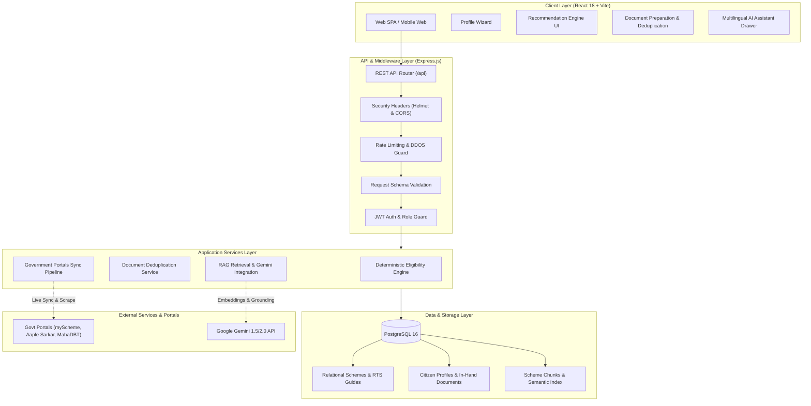

# JanSahay AI 🇮🇳

> **Production-Grade Government Scheme Discovery & Smart Document Guidance Platform**  
> An open-source, citizen-centric GovTech platform that bridges the gap between Indian citizens and public welfare programs through deterministic eligibility evaluation, automated document deduplication, statutory 9-point document acquisition roadmaps, and grounded multilingual AI assistance in **English, Marathi (मराठी), and Hindi (हिंदी)**.

[](LICENSE)
[](client)
[](server)
[](server/src/db)
[](server/src/services)
[](docker-compose.yml)

---

## 📌 Problem Statement

Every year, thousands of welfare schemes and financial subsidies launched by Central and State Governments in India go underutilized. Everyday citizens, students, and marginal farmers struggle with three systemic barriers:

1. **Information Asymmetry & Fragmented Portals**: Welfare schemes are scattered across disconnected portals (`myscheme.gov.in`, `data.gov.in`, `mahadbt.maharashtra.gov.in`, `aaplesarkar.mahaonline.gov.in`), making discovery daunting.
2. **Opaque & Complex Eligibility Criteria**: Guidelines are buried in lengthy gazettes with interdependent requirements (caste category, annual income, domicile, land ceiling, academic qualifications).
3. **The "Document Barrier"**: Citizens frequently face rejection due to missing prerequisite certificates (Income Certificate, Non-Creamy Layer, Caste Validity, 7/12 Land Extract). Many do not know the issuing authority, fees, or statutory delivery timelines mandated under the **Right to Public Services (RTS) Act**.

**JanSahay AI** eliminates this friction by transforming welfare discovery into an automated, transparent, and step-by-step roadmap.

---

## 🌟 Key Features

| Feature | Description |
| :--- | :--- |
| **🎯 Deterministic Eligibility Matching** | Evaluates user demographic, economic, and occupational profiles against rules engine; outputs transparent **Strong Match**, **Potential Match**, or **More Information Required** with condition-by-condition match diagnostics. |
| **📑 Citizen In-Hand Document Registry** | Citizens track certificates already in their possession; when inspecting any scheme, requirements are automatically partitioned into *Ready in Hand* vs *Pending Acquisition*. |
| **🔄 Cross-Scheme Document Deduplication** | Automatically computes common prerequisites across multiple eligible schemes so users prepare documents once without redundant applications. |
| **🗺️ 9-Point Statutory Document Guides** | Comprehensive step-by-step acquisition guides for essential certificates (Income, Domicile, EWS, Caste Validity, 7/12 & 8A, UDID) including issuing officers, RTS SLA timelines, prescribed fees, and official links. |
| **🌐 Native Trilingual Experience** | Instant full-app language toggling across **English**, **Marathi (मराठी)**, and **Hindi (हिंदी)** for all navigation, scheme summaries, and document requirements. |
| **🤖 Source-Grounded Multilingual AI** | Conversational drawer that answers citizen queries strictly against verified scheme data and RTS rules with explicit citations, avoiding AI hallucinations. |
| **📡 Real-Time Government Data Sync** | Continuous ingestion service checking updates from official portals and publishing live notifications and ticker alerts. |
| **🛡️ Administrative Console** | Granular dashboard for public servants to inspect platform telemetry, verify new document guides, and manage scheme catalogs. |

---

## 🏗️ System Architecture



---

## 💻 Tech Stack

### Frontend
| Component | Technology | Version | Purpose |
| :--- | :--- | :--- | :--- |
| **Framework** | React | `^18.3.1` | Component-driven user interface |
| **Build Tool** | Vite | `^5.3.1` | Ultra-fast HMR and optimized production bundling |
| **Routing** | React Router DOM | `^6.24.1` | Declarative client-side routing |
| **HTTP Client** | Axios | `^1.7.2` | REST API communication with JWT interceptors |
| **Icons** | Lucide React | `^0.395.0` | Modern, clean UI iconography |

### Backend & Core Services
| Component | Technology | Version | Purpose |
| :--- | :--- | :--- | :--- |
| **Runtime** | Node.js (ESM) | `v20+ LTS` | Server-side JavaScript runtime |
| **Web Framework** | Express.js | `^4.19.2` | REST API endpoints and routing |
| **Authentication** | JSON Web Tokens (`jsonwebtoken`) | `^9.0.2` | Stateless bearer token authentication |
| **Password Hashing**| BCrypt (`bcryptjs`) | `^2.4.3` | Salted credential encryption |
| **Database** | PostgreSQL | `v16+` | Relational persistence for profiles and schemes |
| **Data Access** | Prisma / Drizzle ORM | Latest | Strongly-typed migrations and queries |
| **AI / RAG** | Google Gemini API | `v1.5 / v2.0` | Grounded question answering and semantic retrieval |

### DevOps & Infrastructure
| Component | Technology | Purpose |
| :--- | :--- | :--- |
| **Containers** | Docker & Docker Compose | Multi-stage production containerization |
| **Reverse Proxy**| Nginx | Static asset caching and SSL termination |
| **CI/CD** | GitHub Actions | Automated linting, test suite execution, and container build |
| **Hosting** | Render / Railway / Netlify | Cloud deployments with managed database |

---

## 🚀 Setup & Installation

### Prerequisites
- **Node.js**: `v18.0.0` or higher
- **npm**: `v9.0.0` or higher
- **PostgreSQL**: `v14+` (or Docker Desktop)
- **Git**

---

### Option A: Local Development Setup

1. **Clone the repository**:
   ```bash
   git clone https://github.com/aryan-pawar2006/JanSahay.git
   cd JanSahay
   ```

2. **Configure environment variables**:
   ```bash
   cp server/.env.example server/.env
   cp client/.env.example client/.env
   ```
   *Update `server/.env` with your PostgreSQL database URL and Gemini API key.*

3. **Install dependencies**:
   ```bash
   cd server && npm install
   cd ../client && npm install
   cd ..
   ```

4. **Initialize & seed database**:
   ```bash
   cd server
   npm run seed
   ```
   *(Demo credentials for development are generated and printed directly to the terminal).*

5. **Start the application**:
   - **Terminal 1 (Backend)**:
     ```bash
     cd server
     npm run dev
     ```
   - **Terminal 2 (Frontend)**:
     ```bash
     cd client
     npm run dev
     ```

6. **Access the application**:
   - Web Application: `http://localhost:5173`
   - Backend API: `http://localhost:5000/api`

---

### Option B: Windows One-Click Quickstart

For Windows developers, automated scripts are located in `scripts/windows`:
```cmd
# 1. First-time setup (installs all dependencies and sets default configs)
.\scripts\windows\setup.bat

# 2. Launch both client and server in dedicated consoles
.\scripts\windows\run.bat
```

---

### Option C: Docker Compose Setup

Run the entire stack with a single command:
```bash
docker compose up --build
```
This boots:
- PostgreSQL service on port `5432`
- Node.js API server on port `5000`
- React frontend on port `5173`

---

## ⚙️ Environment Variables

### Server (`server/.env`)
| Variable | Required | Default | Description |
| :--- | :---: | :--- | :--- |
| `PORT` | No | `5000` | Port on which the Express server listens |
| `NODE_ENV` | Yes | `development` | Environment mode (`development` or `production`) |
| `DATABASE_URL` | Yes | - | PostgreSQL connection URL |
| `JWT_SECRET` | Yes | - | Secret key for signing access tokens (min 32 chars) |
| `JWT_EXPIRES_IN` | No | `1h` | Expiration window for access tokens |
| `JWT_REFRESH_SECRET` | Yes | - | Secret key for signing refresh tokens |
| `JWT_REFRESH_EXPIRES_IN` | No | `7d` | Expiration window for refresh tokens |
| `CORS_ORIGIN` | No | `http://localhost:5173` | Comma-separated list of allowed CORS origins |
| `RATE_LIMIT_WINDOW_MS` | No | `900000` (15m) | Rate limiting calculation window |
| `RATE_LIMIT_MAX_REQUESTS` | No | `100` | Max requests per IP within the window |
| `AI_PROVIDER` | No | `deterministic` | AI mode: `gemini` or `deterministic` |
| `GEMINI_API_KEY` | Conditional | - | Required when `AI_PROVIDER=gemini` |
| `LOG_LEVEL` | No | `info` | Logging verbosity (`debug`, `info`, `warn`, `error`) |

### Client (`client/.env`)
| Variable | Required | Default | Description |
| :--- | :---: | :--- | :--- |
| `VITE_API_URL` | Yes | `http://localhost:5000/api` | Base URL of the backend REST API |

---

## 📚 REST API Summary

| Method | Endpoint | Access | Description |
| :--- | :--- | :---: | :--- |
| `POST` | `/api/auth/register` | Public | Register a new citizen account |
| `POST` | `/api/auth/login` | Public | Authenticate user and receive JWT bearer tokens |
| `GET` | `/api/auth/me` | Authenticated | Fetch current user session details |
| `GET` | `/api/profile` | Authenticated | Retrieve citizen demographic and socio-economic profile |
| `POST` | `/api/profile` | Authenticated | Create or update citizen profile |
| `GET` | `/api/schemes` | Public | List government schemes with filters (category, state, search) |
| `GET` | `/api/schemes/:id` | Public | Retrieve detailed scheme facts, criteria, and official links |
| `GET` | `/api/schemes/:id/documents`| Public | Fetch required documents for a given scheme |
| `GET` | `/api/schemes/:id/document-readiness` | Authenticated | Compare required documents against citizen's in-hand registry |
| `GET` | `/api/recommendations` | Authenticated | Evaluate profile and compute matched schemes with match type |
| `GET` | `/api/documents` | Authenticated | List all citizen in-hand documents |
| `PUT` | `/api/documents/status` | Authenticated | Update in-hand status (`HAVE_ORIGINAL`, `PENDING`, etc.) |
| `GET` | `/api/documents/guides` | Public | Catalog of 9-point statutory document guides |
| `GET` | `/api/documents/guides/:id` | Public | Full RTS guide (timeline, issuing authority, workflow steps) |
| `POST` | `/api/ai/chat` | Public / Auth | Multilingual query answering with verified citations |
| `POST` | `/api/ai/explain/:id` | Public | Contextual scheme breakdown in citizen's selected language |
| `GET` | `/api/realtime/live-ticker` | Public | Real-time news ticker of latest welfare announcements |
| `POST` | `/api/realtime/sync` | Admin | Trigger upstream scraping and portal synchronization |
| `GET` | `/api/admin/dashboard` | Admin | System statistics, scheme counts, and user metrics |

---

## 🔒 Security & Demo Access Notice

> [!IMPORTANT]
> - **Production Hardened**: In accordance with global security practices, demo credentials are **never hardcoded in documentation or committed files**.
> - **Development Seeding**: When running in `development` mode (`NODE_ENV=development`), the initial database seed script dynamically provisions isolated development profiles (e.g. System Administrator, Student, Farmer) and prints temporary local credentials securely to your local console output.
> - **Production Safeguards**: All default development accounts are permanently disabled when `NODE_ENV=production`.

---

## 🖼️ Application Interface & Walkthrough

Here are the primary user touchpoints of the JanSahay platform:

| Screen | Purpose |
| :--- | :--- |
| **🏠 Citizen Discovery Portal** | Searchable catalog of 30+ central and state schemes with dynamic filters. |
| **🧙 Profile Evaluation Wizard** | 4-step wizard capturing demographics, income, education, occupation, and landholding. |
| **📊 Recommendation Dashboard** | Matches ranked as *Strong*, *Potential*, or *Needs Info* with transparent rule breakdown. |
| **📋 Document Preparation Workspace** | Cross-scheme deduplicated checklist separating in-hand certificates from pending ones. |
| **📜 9-Point Statutory RTS Guide** | Point-wise acquisition workflows, issuing offices, statutory days, and fees. |
| **💬 Multilingual AI Drawer** | Instant citizen Q&A with strict citations in English, Marathi, and Hindi. |
| **🛠️ Administrative Console** | Scheme lifecycle management, guide verification, and telemetry. |

---

## 🗺️ Engineering Roadmap (Portfolio Evolution)

- [x] **Phase 1: Repo Hygiene & Documentation** — Clean directory structure, Windows helper scripts, comprehensive Mermaid architecture, environment configuration templates, and security scrubbing.
- [ ] **Phase 2: Production Database** — Migrate from local JSON storage to PostgreSQL with Prisma/Drizzle ORM, schema migrations, and relational integrity.
- [ ] **Phase 3: Security & Input Validation** — Helmet headers, CORS whitelist, express-rate-limit, Zod request validation schemas, centralized error logging, and `/api/health` checks.
- [ ] **Phase 4: Testing & Quality Assurance** — Vitest/Supertest integration, unit tests for deterministic eligibility rules, document deduplication algorithms, and 70%+ coverage.
- [ ] **Phase 5: Grounded RAG AI Assistant** — Vector embeddings, top-k chunk retrieval with Google Gemini API, verified citations, and trilingual evaluation benchmarks.
- [ ] **Phase 6: DevOps & Cloud Infrastructure** — Multi-stage production Dockerfiles, Docker Compose orchestrator, GitHub Actions CI/CD pipeline, and Render/Netlify deployment guides.
- [ ] **Phase 7: Product Polish & PWA** — Offline scheme caching, export to PDF recommendations, accessibility audit (WCAG AA), and citizen telemetry.

---

## 📄 License

This project is licensed under the [MIT License](LICENSE) — see the LICENSE file for details.
