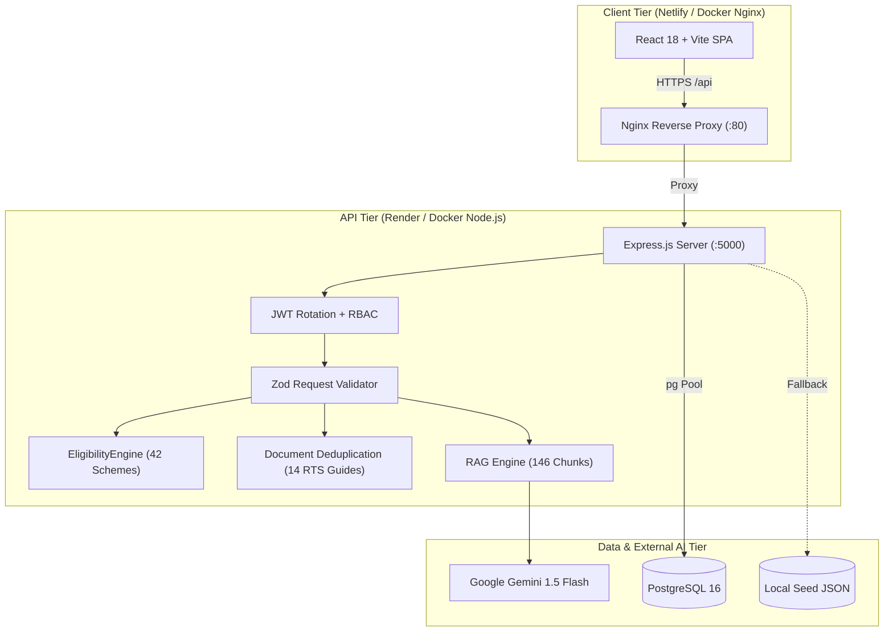

# 📘 JanSahay AI — Operations & DevOps Runbook

> **Author**: Dharshan Mende ([@dharshanmende-afk](https://github.com/dharshanmende-afk))  
> **Repository**: [https://github.com/dharshanmende-afk/jansahay](https://github.com/dharshanmende-afk/jansahay)  
> **Production Frontend**: [https://creative-mochi-5f7e5c.netlify.app/](https://creative-mochi-5f7e5c.netlify.app/)  
> **Classification**: Operations, Incident Response, & Cloud Deployment Guide

---

## 1. System Architecture Overview



---

## 2. Quickstart Execution Runbook

### Option A: One-Command Docker Compose (Recommended)
Spins up PostgreSQL 16, Node.js API Server, and Nginx-fronted Web Client:

```bash
# Clone and enter workspace
git clone https://github.com/dharshanmende-afk/jansahay.git
cd jansahay

# Copy and configure environment variables
cp .env.example .env

# Launch entire production stack
docker compose up --build -d

# Check service status
docker compose ps

# View unified logs
docker compose logs -f
```

- **Web Frontend**: `http://localhost` (or `http://localhost:80`)
- **API Server & Health Probe**: `http://localhost:5000/api/health`
- **PostgreSQL Database**: `localhost:5432` (`jansahay_db`)

---

### Option B: Local Development (Bare Metal)

```powershell
# 1. Setup Backend Server
cd server
npm.cmd install
npm.cmd run seed          # Seeds 42 verified schemes and 14 RTS guides
npm.cmd run dev           # Starts API with file-watcher on port 5000

# 2. Setup Frontend Client (in a separate terminal)
cd ..\client
npm.cmd install
npm.cmd run dev           # Starts Vite dev server on http://localhost:5173
```

---

## 3. Observability & Health Probing

### 3.1 Health Check Endpoint
The server exposes an automated health diagnostic probe at `GET /api/health`:

```bash
curl -s http://localhost:5000/api/health | jq .
```

**Expected JSON Response Contract**:
```json
{
  "status": "UP",
  "name": "JanSahay AI Server",
  "timestamp": "2026-03-15T12:00:00.000Z",
  "database": {
    "engine": "PostgreSQL",
    "connected": true,
    "schemesCount": 42,
    "documentGuidesCount": 14
  },
  "services": {
    "eligibilityEngine": "OPERATIONAL",
    "documentAnalysis": "OPERATIONAL",
    "ragEngine": "OPERATIONAL"
  }
}
```

### 3.2 Request Logging (Morgan Structured Format)
In `production` mode, requests are logged in standard Apache combined format. In `development`, color-coded status, method, and response times in milliseconds are streamed to standard output.

---

## 4. Test Suites & Benchmarking

| Test Command | Scope | Target |
| :--- | :--- | :---: |
| `npm run test:unit` | Eligibility rules, operators, edge cases, deduplication | 100% Pass |
| `npm run test:integration` | Supertest auth lifecycle, refresh tokens, profile, catalog, RBAC | 100% Pass |
| `npm run eval:rag` | 31 multilingual benchmark questions (EN, HI, MR, Out-of-Scope) | 100% Accuracy |
| `npm run test:coverage` | C8 code coverage across all business logic and routes | >70% Coverage |

```powershell
cd server
npm.cmd run test
npm.cmd run eval:rag
npm.cmd run test:coverage
```

---

## 5. Database Disaster Recovery & Migrations

### 5.1 Run Migrations
```bash
cd server
npm run migrate
```
Executes `server/src/db/migrations/001_initial_schema.sql` on the target PostgreSQL database specified by `DATABASE_URL`.

### 5.2 Backup PostgreSQL
```bash
pg_dump -h localhost -p 5432 -U postgres -d jansahay_db -F c -b -v -f jansahay_backup_$(date +%Y%m%d).dump
```

### 5.3 Restore Database
```bash
pg_restore -h localhost -p 5432 -U postgres -d jansahay_db -v -c jansahay_backup_20260315.dump
```

---

## 6. Incident Response & Troubleshooting

### Scenario 1: Port 5000 / 80 Already in Use
**Symptom**: `Error: listen EADDRINUSE: address already in use :::5000`  
**Remediation (Windows PowerShell)**:
```powershell
Get-NetTCPConnection -LocalPort 5000 | ForEach-Object { Stop-Process -Id $_.OwningProcess -Force }
```
**Remediation (Linux / Docker)**:
```bash
sudo lsof -i :5000 | awk 'NR>1 {print $2}' | xargs -r kill -9
```

### Scenario 2: 429 Too Many Requests (Rate Limiter Triggered)
**Symptom**: Client receives `HTTP 429 Too Many Requests` during load testing.  
**Root Cause**: Strict rate limits are enforced via `express-rate-limit`:
- Global limit: 100 requests / 15 minutes
- Auth limit: 15 requests / 15 minutes (`/api/auth/*`)
- AI Chat limit: 30 requests / 15 minutes (`/api/ai/chat`)  
**Remediation**: Adjust `RATE_LIMIT_MAX_REQUESTS` in `.env` or white-list trusted IPs in `server/src/middleware/rateLimiter.js`.

### Scenario 3: JWT Token Expired (401 Unauthorized)
**Symptom**: Citizens filling multi-step profile wizards receive `401 Unauthorized` after 1 hour.  
**Resolution**: The frontend Axios client in `client/src/services/api.js` automatically catches 401 errors and calls `POST /api/auth/refresh` using the stored refresh token (7-day validity), updating the Bearer token transparently without interrupting the user.

### Scenario 4: CORS Errors on Custom Deployments
**Symptom**: `Access-Control-Allow-Origin header missing`.  
**Remediation**: Add the new domain to `CORS_ORIGIN` in `.env` or Render environment settings:
```ini
CORS_ORIGIN=https://creative-mochi-5f7e5c.netlify.app,https://your-custom-domain.com
```

---

## 7. Cloud Deployment Checklist

### Frontend (Netlify)
1. **Repository**: Link `https://github.com/dharshanmende-afk/jansahay`
2. **Build Settings**:
   - Base Directory: `client`
   - Build Command: `npm run build`
   - Publish Directory: `client/dist`
3. **Environment Variables**:
   - `VITE_API_BASE_URL`: `https://jansahay-backend.onrender.com`

### Backend (Render / Railway)
1. **Blueprint**: Deploy using `render.yaml`
2. **Database**: PostgreSQL 16 (provisioned automatically)
3. **Environment Variables**:
   - `NODE_ENV`: `production`
   - `PORT`: `10000` (Render default)
   - `DATABASE_URL`: Linked from Render PostgreSQL database
   - `JWT_SECRET`: Auto-generated 32+ character random secret
   - `JWT_REFRESH_SECRET`: Auto-generated 32+ character random secret
   - `GEMINI_API_KEY`: Google Gemini API key
